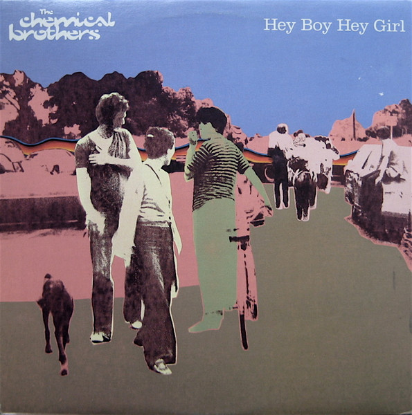
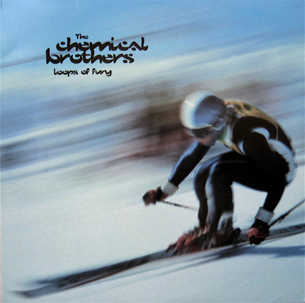

# VinylKit

[](https://github.com/alaninspace/vinyl-kit/tags)
[](https://vinylkit.app/)

VinylKit is a cross-platform CLI tool for managing digitized vinyl record audio files using metadata from Discogs. It helps you tag, organize, and maintain your collection with high-quality metadata.

## See It in Action

Two needledrops, straight off the turntable, still called `01.flac`, `02.flac`… One command later they are tagged, renamed, filed in your library with cover art, and showing up in Roon.

<div class="see-it">
<div class="see-it-step">
<p class="see-it-label"><strong>1 · Drop</strong> recordings_root</p>
<pre>Recordings
├── 4008-The-Chemical-Brothers-Hey-Boy-Hey-Girl
│   ├── 01.flac
│   ├── 02.flac
│   └── 03.flac
└── 13299-The-Chemical-Brothers-Loops-Of-Fury
    ├── 01.flac
    ├── 02.flac
    ├── 03.flac
    └── 04.flac</pre>
</div>
<div class="see-it-step see-it-terminal">
<p class="see-it-label"><strong>2 · Run</strong> one command</p>
<pre>&gt; vinylkit tag --id 4008,13299
&nbsp;
Processing folder: …\4008-The-Chemical-Brothers-Hey-Boy-Hey-Girl
Tagged 3 tracks
Files moved successfully.
&nbsp;
Processing folder: …\13299-The-Chemical-Brothers-Loops-Of-Fury
Tagged 4 tracks
Files moved successfully.</pre>
</div>
<div class="see-it-step">
<p class="see-it-label"><strong>3 · Filed</strong> library_root</p>
<pre>Music
└── The Chemical Brothers
    ├── 1999 - Hey Boy Hey Girl [Astralwerks]
    │   ├── A - Hey Boy Hey Girl (Extended Version).flac
    │   ├── B1 - Flashback.flac
    │   ├── B2 - Scale.flac
    │   └── folder.jpg
    └── 1996 - Loops Of Fury [Astralwerks]
        ├── A1 - Loops Of Fury.flac
        ├── A2 - (The Best Part Of) Breaking Up.flac
        └── … 2 more tracks, folder.jpg, images/</pre>
</div>
<div class="see-it-step">
<p class="see-it-label"><strong>4 · Play</strong> Roon · Plex</p>
<div class="see-it-covers">
<figure><figcaption>Hey Boy Hey Girl · 1999</figcaption></figure>
<figure><figcaption>Loops Of Fury · 1996</figcaption></figure>
</div>
</div>
</div>

Walk through it step by step in the **[Quickstart](docs/quickstart.md)**.

## Features

- **Discogs Integration**: Fetch high-quality metadata (Genres, Styles, Notes) using Release IDs or interactive search.
- **Combined Workflow**: Tag, rename and move files to your library in a single step.
- **Support for MP3 and FLAC**: Comprehensive tagging for ID3v2 and Vorbis comments.
- **Vinyl-Specific Metadata**: Preserves vinyl-specific info like side (A/B) and position (A1, B2).
- **Metadata Export**: Automatically creates a `release_info.txt` file in every tagged album folder with all the discogs release info.
- **Safe Operations**: Optional dry-runs, filename sanitization, and atomic file moves.
- **Batch Processing**: Use `--batch` to automatically tag multiple folders, extracting Discogs IDs from folder names.
- **Artwork Management**: Embed album art directly into audio files (retrieved from Discogs).
- **Flexible Organization**: Use customizable naming templates to organize your library.
- **Collection Export**: Download your entire Discogs collection to a local CSV file.

## Installation

There are a few ways to install VinylKit. Pick the one that fits your setup:

### Option 1: Standalone Installer

This doesn't require Python or any package managers. The script automatically detects your system and installs a pre-compiled binary:

* **macOS & Linux (Bash/Zsh):**
  ```bash
  curl -fsSL https://vinylkit.app/install.sh | bash
  ```
* **Windows (PowerShell):**
  ```powershell
  irm https://vinylkit.app/install.ps1 | iex
  ```

### Option 2: Python / Developer Tool (`uv`)

If you already have Python and `uv` installed, you can install it as a global tool:

```bash
uv tool install git+https://github.com/alaninspace/vinyl-kit.git
```

*For other installation options—including manual PyInstaller executables, PyApp bootstrappers, Homebrew, and Scoop—see the full **[Download & Install Guide](docs/download.md)**.*

## Quick Start

1. **Set your library location** (where tagged music ends up):

   ```bash
   vinylkit config set library_root "/path/to/VinylLibrary"
   ```

2. **Set your recordings inbox** (where new vinyl recordings are placed):

   ```bash
   vinylkit config set recordings_root "/path/to/RecordedVinyl"
   ```

3. **Set your Discogs token** ([generate one here](https://www.discogs.com/settings/developers)):

   ```bash
   vinylkit config set discogs_token "YOUR_TOKEN"
   ```

4. **Scan and tag**:

   ```bash
   vinylkit scan
   vinylkit tag --id 19983
   ```

> [!TIP]
> For OAuth setup, naming patterns, and other configuration settings, see the **[Quickstart Guide](docs/quickstart.md)**.

## Configuration

Settings are stored in a TOML file. You can view your current configuration with:

```bash
vinylkit config show
```

For more details, check out **[vinylkit.app](https://vinylkit.app/)** or see these local files:

- **[Quick Start](docs/quickstart.md)**: Setup and basic workflow.
- **[User Guide](docs/user-guide.md)**: In-depth command and feature reference.
- **[Examples](docs/examples.md)**: Real-world command combinations.
- **[Configuration Guide](docs/configuration.md)**: Full list of all settings.
- **[Developer Guide](docs/developer-guide.md)**: Setup, code architecture, and testing.
- **[Authentication Guide](docs/auth.md)**: Setting up Discogs credentials and OAuth.
- **[Tag Mapping Reference](docs/tag-mapping.md)**: Complete tag list with MP3/FLAC field names.
- **[Data Model Reference](docs/data-model.md)**: Data structures, database types, and schemas.
- **[Specification Spec](docs/spec.md)**: Product specs and technical requirements.
