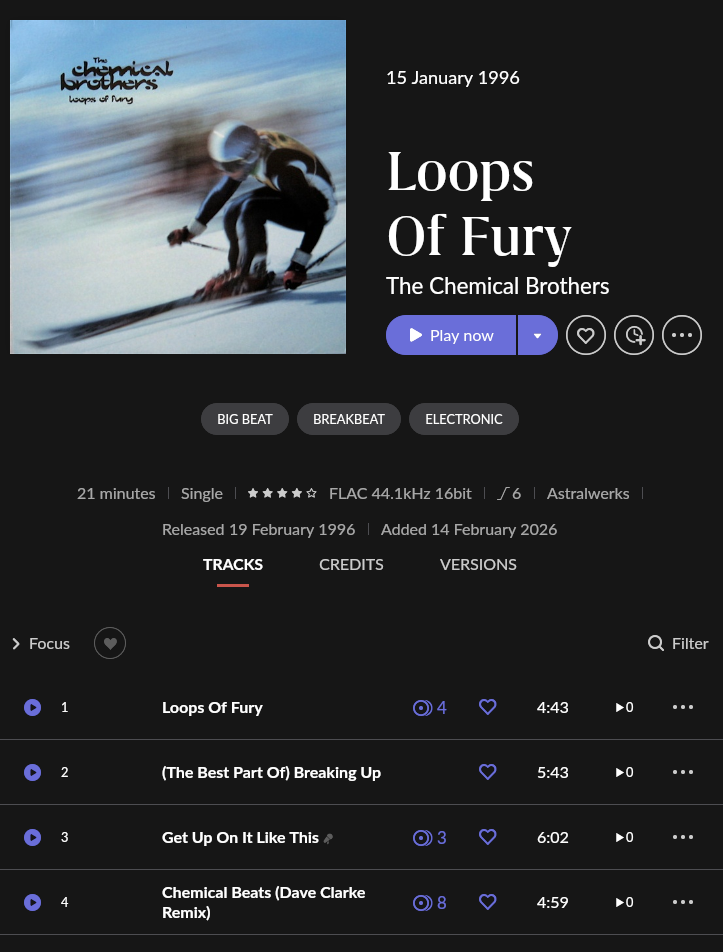

# Quickstart: VinylKit CLI

## Installation

There are a few ways to install VinylKit. Pick the one that fits your setup:

### Option 1: Standalone Installer

To get VinylKit running without manually setting up Python or package managers:

* **macOS & Linux (Bash/Zsh):**
  ```bash
  curl -fsSL https://vinylkit.app/install.sh | bash
  ```
* **Windows (PowerShell):**
  ```powershell
  irm https://vinylkit.app/install.ps1 | iex
  ```

### Option 2: Python / Developer Tool (`uv`)

For developers and power users who already have Python and `uv` installed:

```bash
uv tool install git+https://github.com/alaninspace/vinyl-kit.git
```

> [!TIP]
> **Migrating from `uv` to a standalone executable?** If you already have VinylKit installed globally via `uv`, make sure to run `uv tool uninstall vinylkit` before installing the standalone version to avoid system `PATH` conflicts!

*For alternative installation options—including manual PyInstaller downloads, PyApp bootstrappers, Homebrew, and Scoop—see the full **[Download & Install Guide](download.md)**.*

---

## Setup & Configuration

VinylKit needs to know where your music library is, where you put your new recordings, and how to talk to Discogs.

### 1. Set your Library Location

This is where your tagged and organized music library will live.

**Bash:**

```bash
vinylkit config set library_root ~/Music/VinylLibrary
```

**PowerShell:**

```powershell
vinylkit config set library_root "D:\Music\VinylLibrary"
```

### 2. Set your Recordings Location (The "Inbox")

This is where you place your new vinyl recordings (e.g. `01.flac`, `02.flac`) before tagging them. Setting this lets you run commands without typing the folder path every time.

**Bash:**

```bash
vinylkit config set recordings_root ~/Recordings/Vinyl
```

**PowerShell:**

```powershell
vinylkit config set recordings_root "C:\Temp\RecordedVinyl"
```

### 3. Authenticate with Discogs

See the [Authentication Guide](auth.md) for detailed steps.

**Quick Start (Personal Access Token):**

```bash
# Bash / PowerShell
vinylkit config set discogs_token "YOUR_TOKEN"
```

> [!TIP]
> For a full list of all settings (backups, custom filenames, tagging modes), see the **[Configuration Guide](configuration.md)**.

### 4. Advanced Artwork Collection

By default, VinylKit only downloads the primary cover. You can enable full collection:

```bash
# Bash / PowerShell
# Download all images from the release
vinylkit config set collect_all_artwork true

# Customize the artwork subdirectory name
vinylkit config set artwork_subdir "Scans"
```

### 5. Folder Structure & Naming

You can control exactly how your library is organized and how deep the folders are by changing the `naming_pattern`.

**Available Placeholders:** `{artist}`, `{album}`, `{year}`, `{id}`, `{track_number}`, `{title}`, `{label}`, `{catalogue_number}`, `{side}`, `{genre}`, `{style}`, `{country}`, and more. See the [Configuration Guide — `naming_pattern`](configuration.md#naming_pattern) for the full list.

**Examples:**

- **Standard Chronological (Default):** `Artist / Year - Album / Track - Title`

```bash
# Bash / PowerShell
vinylkit config set naming_pattern "{artist}/{year} - {album}/{track_number} - {title}"
```

- **Deep Parentheses:** `Artist / Album (Year) / Track - Title`

```bash
# Bash / PowerShell
vinylkit config set naming_pattern "{artist}/{album} ({year})/{track_number} - {title}"
```

- **Flat Album Folders:** `Year - Artist - Album / Track - Title` (One folder per album)

```bash
# Bash / PowerShell
vinylkit config set naming_pattern "{year} - {artist} - {album}/{track_number} - {title}"
```

- **Completely Flat:** Everything in one folder

```bash
# Bash / PowerShell
vinylkit config set naming_pattern "{year} - {id} - {artist} - {album} - {track_number} - {title}"
```

---

## Your First Tag & Move

Here is the whole loop with two real records, from a drop folder of untitled FLACs to finished albums in Roon. It uses the settings from Setup & Configuration above; these are the ones that matter here:

```toml
recordings_root     = "D:\\Recordings"
library_root        = "D:\\Music"
naming_pattern      = "{artist}/{year} - {album} [{label}]/{track_number} - {full_title}"
auto_move           = true
collect_all_artwork = true
track_numbering     = "numeric"
```

### 1. Drop Your Recordings

Record each side, save the tracks in order, and put each record in its own folder inside `recordings_root`. The file names don't matter; the order does.

```text
D:\Recordings
├── 4008-The-Chemical-Brothers-Hey-Boy-Hey-Girl
│   ├── 01.flac
│   ├── 02.flac
│   └── 03.flac
└── 13299-The-Chemical-Brothers-Loops-Of-Fury
    ├── 01.flac
    ├── 02.flac
    ├── 03.flac
    └── 04.flac
```

> [!TIP]
> **Name the folder from the Discogs URL.** Copy the end of the release link (`discogs.com/release/4008-The-Chemical-Brothers-Hey-Boy-Hey-Girl`) and VinylKit reads the release ID from the front of the folder name.

### 2. Run One Command

Pass both IDs, comma-separated. VinylKit finds each folder in `recordings_root`, fetches the release from Discogs, tags the files, and moves them into your library.

```bash
# Bash / PowerShell
vinylkit tag --id 4008,13299
```

What you'll see:

```text
Processing folder: D:\Recordings\4008-The-Chemical-Brothers-Hey-Boy-Hey-Girl
Loaded Release: The Chemical Brothers - Hey Boy Hey Girl (1999)

╭─── Tagging Complete ────╮
│ Tagged 3 tracks         │
│ Saved 6 artwork file(s) │
╰─────────────────────────╯

Renaming files in 4008-The-Chemical-Brothers-Hey-Boy-Hey-Girl...
A - Hey Boy Hey Girl (Extended Version) -> The Chemical Brothers/1999 - Hey Boy Hey Girl [Astralwerks]/A - Hey Boy Hey Girl (Extended Version).flac
B1 - Flashback -> The Chemical Brothers/1999 - Hey Boy Hey Girl [Astralwerks]/B1 - Flashback.flac
B2 - Scale -> The Chemical Brothers/1999 - Hey Boy Hey Girl [Astralwerks]/B2 - Scale.flac

Files moved successfully.

Processing folder: D:\Recordings\13299-The-Chemical-Brothers-Loops-Of-Fury
Loaded Release: The Chemical Brothers - Loops Of Fury (1996)

╭─── Tagging Complete ────╮
│ Tagged 4 tracks         │
│ Saved 5 artwork file(s) │
╰─────────────────────────╯

Renaming files in 13299-The-Chemical-Brothers-Loops-Of-Fury...
A1 - Loops Of Fury -> The Chemical Brothers/1996 - Loops Of Fury [Astralwerks]/A1 - Loops Of Fury.flac
...

Files moved successfully.
```

### 3. Check Your Library

Each record now has its own folder under `library_root`, built from your `naming_pattern`, with the cover as `folder.jpg`, every Discogs image in `images/`, and the full release notes in `00-release-info.txt`. The drop folders are left empty.

```text
D:\Music
└── The Chemical Brothers
    ├── 1999 - Hey Boy Hey Girl [Astralwerks]
    │   ├── images
    │   ├── 00-release-info.txt
    │   ├── A - Hey Boy Hey Girl (Extended Version).flac
    │   ├── B1 - Flashback.flac
    │   ├── B2 - Scale.flac
    │   └── folder.jpg
    └── 1996 - Loops Of Fury [Astralwerks]
        ├── images
        ├── 00-release-info.txt
        ├── A1 - Loops Of Fury.flac
        ├── A2 - (The Best Part Of) Breaking Up.flac
        ├── B1 - Get Up On It Like This.flac
        ├── B2 - Chemical Beats (Dave Clarke Remix).flac
        └── folder.jpg
```

> [!NOTE]
> **Vinyl sides in the file names, plain numbers in the tags.** Files are named `A1`, `B2`… from the Discogs tracklist, while `track_numbering = "numeric"` writes the track numbers as 1, 2, 3, 4 so Roon plays them in order. The original side and position stay in the `SIDE` and `DISCOGS_POSITION` tags.

### 4. Open It in Roon

Point Roon (or Plex) at `library_root`. The cover, artist, label, genre and styles, and track numbers all come from the tags VinylKit wrote. Roon can add its own details on top, such as release dates, if you let it.



*Loops Of Fury in Roon, straight after tagging. Big Beat, Breakbeat, Electronic, Astralwerks and tracks 1–4 are all read from the files' tags.*

---

## Common Workflows

If you configure your `recordings_root`, tagging files becomes much simpler because you don't have to specify the path every time.

### Scenario: Tagging and Moving a New Recording

If you just finished recording an album and the files are in your default recordings folder:

```bash
# Bash / PowerShell

# 1. Scan to see the files in your Recordings folder
vinylkit scan

# 2. Tag, Create release_info.txt, and Rename/Move to library in one go
# (Example: Jeff Mills - Kat Moda EP)
vinylkit tag --id 165
```

### Scenario: Tagging a specific folder

To tag files outside your default recordings folder, specify the path in the command:

**Bash:**

```bash
# Explicit path provided: --rename is NOT automatic in this workflow, must be added
# (Example: Krafty Kuts - Lost Plates E.P.)
vinylkit tag ~/Downloads/vinyl-rip --id 56903 --rename
```

**PowerShell:**

```powershell
# Explicit path provided: --rename is NOT automatic in this workflow, must be added
# (Example: Krafty Kuts - Lost Plates E.P.)
vinylkit tag "C:\Some\Other\Folder" --id 56903 --rename
```

### Scenario: Batch tagging multiple releases

> [!IMPORTANT]
> **Configuration Requirement:** Batch tagging requires setting your `recordings_root` (see Step 2 under Setup & Configuration), because the command scans this directory for folders named with Discogs IDs.

Name your folders with the Discogs ID so VinylKit can pick it up automatically. Three formats are supported:

- Bracket suffix: `Album Name [12345]`
- Bare numeric: `12345`
- URL-style prefix (copy-paste from the Discogs URL): `12345-Artist-Album-Title`

Then tag them all at once:

```bash
# Bash / PowerShell

# Tag, rename, and move to library
vinylkit tag --batch --auto-move

# Tag and rename in place (don't move to library)
vinylkit tag --batch --no-move
```

---

## Available Commands

Here is what you can run:

- **`scan`** — View audio files and their tagging status.
- **`tag`** — Tag files using a Discogs Release ID or interactive search, with optional rename/move.
- **`rename`** — Move already-tagged files into your library structure (dry-run by default).
- **`migrate`** — Migrate an existing library to the new folder structure.
- **`auth`** — Manage Discogs authentication (login, identity).
- **`config`** — View and update persistent settings.
- **`cache`** — List and clear cached Discogs API responses.
- **`collection`** — Download your Discogs collection as CSV.

For full syntax, options, and search tips, see the **[User Guide — Command Reference](user-guide.md#3-command-reference)**.

---

## Next Steps

- **[User Guide](user-guide.md)** — In-depth command reference, tagging details, and workflows.
- **[Examples Guide](examples.md)** — Real-world scenarios and command combinations.
- **[Configuration Guide](configuration.md)** — Full list of all settings with defaults and examples.

## Where is my config?

Your settings and keys live in a standard config file on your system:

- **Windows**: `%LOCALAPPDATA%\vinylkit\vinylkit\config.toml`
- **macOS**: `~/Library/Application Support/vinylkit/config.toml`
- **Linux**: `~/.config/vinylkit/config.toml`

Running `uv tool install --force` **will not** delete or reset these files.
